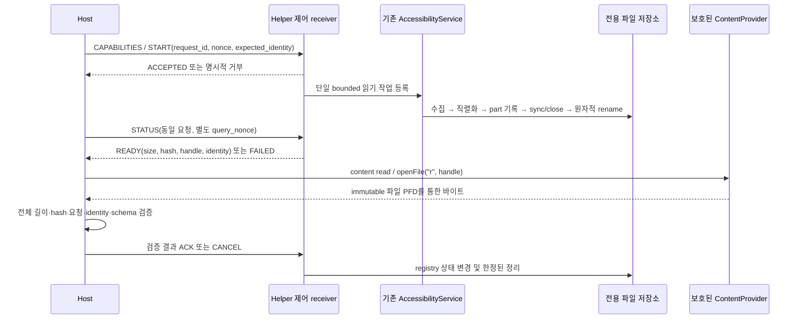

# Hierarchy payload 전송 교체 설계 검토

작성일: 2026-10-18. 범위: 보존 증거와 코드에 대한 읽기 전용 검토 및 설계 문서 작성.

## 1. 결론과 현재 상태

**권고안은 `작은 ordered-broadcast 제어 메시지 + 앱 전용 원자적 파일 + 보호된 ContentProvider/ParcelFileDescriptor 읽기`이다.** 본문은 파일 디스크립터와 ADB 바이트 스트림으로 전달한다. Binder는 작은 메타데이터와 파일 디스크립터만 전달한다. logcat은 진단 경로로 유지한다.

이는 구현 방향에 대한 결론이다. 신규 채널의 기기 호환성이나 무손실 전달이 실증되었다는 판정은 아니다. 후속 구현과 읽기 전용 수락 게이트가 필요하다. 전송 장애가 발생하면 완전한 응답 대신 명시적 실패를 반환한다. 연결 단절 상황까지 전달 성공을 보장하거나, 정확히 한 번 전달을 주장하지 않는다.

```text
HIERARCHY_TRANSPORT_ARCHITECTURE_VERDICT=REPLACEMENT_DESIGN_RECOMMENDED_WITH_GATES
CHOSEN_TRANSPORT=ORDERED_CONTROL_PRIVATE_ATOMIC_FILE_CONTENT_PROVIDER_PFD
LOGCAT_HIERARCHY_PAYLOAD_RELIABLE=NO
DIRECT_BINDER_FULL_PAYLOAD_APPROVED=NO
IMPLEMENTATION_PERFORMED=NO
DEVICE_COMMANDS_EXECUTED=0
HIERARCHY_REQUESTS_EXECUTED=0
SCENARIO31_EXECUTED=NO
SCENARIO32_EXECUTED=NO
FULL32_EXECUTED=NO
PHASE6_STARTED=NO
SAFE_TO_RERUN_SCENARIO31=NO
CANONICAL_STATUS_CHANGED=NO
COMMIT_PERFORMED=NO
PUSH_PERFORMED=NO
```

Phase 5는 `PASS_WITH_LIMITATIONS`, Scenario 31/32는 각각 `INCOMPLETE_SAFETY_LIMIT`, Phase 6은 `NOT_STARTED`를 유지한다.

## 2. 소스와 로컬 작업 보존

실제 소스 경로: `out/phase3_current_main_20261011/source`.

```text
BRANCH=integration/phase3-current-main
START_HEAD=e12f7286be1d6467b593f5ba5fa5445f40428dd5
ORIGIN_INTEGRATION_HEAD=7a7e608b300df2955f335fe816d0741183c07253
MAIN_HEAD=6cb2fe21c4006caa1d188a97a69cf2a6409ee9ee
ORIGIN_MAIN=6cb2fe21c4006caa1d188a97a69cf2a6409ee9ee
TRACKED_WORKTREE_STATUS=EXISTING_LOCAL_CHANGES
```

원격 조회·fetch·checkout·reset·clean·rebase·squash를 실행하지 않았다. origin 값은 로컬에 보존된 remote-tracking ref이다. PREPOSITIONED optional-expansion 비활성화, optional skip audit, repeat suppression, publication ledger, ordered report, continuous capture, overnight 도구·테스트를 보존했다.

검토 시작 시 기존 수정/미추적 파일 중 `out/`, `s1/` 밖의 파일 19개 해시, tracked diff 해시 및 ref를 기록했다. 종료 시 같은 파일과 diff/ref를 대조한다. 기록은 [preservation_baseline.json](../../out/hierarchy_reliable_channel_review_20261018/preservation_baseline.json), 종료 결과는 [preservation_result.json](../../out/hierarchy_reliable_channel_review_20261018/preservation_result.json)에 둔다. 새 산출물은 이 문서와 검토용 메타데이터뿐이다.

## 3. 확정된 장애 범위

근거: [soak_summary.json](../../out/hierarchy_publication_overnight_soak_20261017_1433Z/soak_summary.json), 같은 디렉터리의 `iterations.jsonl` 및 각 iteration의 원문/ledger/비교 결과.

| 항목 | 보존 증거 |
| --- | --- |
| 요청 | 60회, 완전 수신 37회, 전송 실패 23회 |
| 요청 실패율 | 23/60 = 38.33% |
| 프레임 | 3,780개 게시 시도, Log.i 양수 반환 3,780개 |
| 양쪽 수신기에서 동일하게 누락 | 224/3,780 = 5.93% |
| 패턴 | 22회는 sequence 53–62, 1회는 59–62 누락 |
| sequence 의미 | 0–61은 CHUNK, **62 자체가 END**이다. END를 추가로 중복 계산하지 않는다 |
| 무결성 보호 | 모든 부분 응답 거부 |
| 배제된 원인 | 요청 ID 불일치, 미시도 프레임, Log API 실패, parser 단독 실패, runner 단독 실패, 서비스 lifecycle 실패는 각각 0 |

독립 raw logcat과 runner가 같은 suffix를 받지 못했다. 양수 `Log.i` 반환 이후 host-visible logcat 이전 구간의 손실은 확인되었다. Android logging stack 내부의 정확한 하위 계층은 분리되지 않았다. logd 버퍼 크기, 로그 빈도 또는 timeout을 바꾸면 해결된다고 단정할 근거가 없다.

기존 publication ledger는 **구성/게시 시도 증거**이다. API 성공은 host 수신 증거가 아니다. 신규 파일 생성 성공이나 PFD 반환 성공 역시 host 수신 성공으로 간주하지 않는다.

## 4. 현재 코드 경로와 유지할 경계

| 구간 | 현재 파일/함수 | 교체 시 역할 |
| --- | --- | --- |
| 계층 획득 | `A11yNavigator.kt: dumpHierarchy`, `hierarchyNodeToJson` | 기존 AccessibilityService의 window/root 획득 유지 |
| 서비스 위임 | `A11yHelperService.kt: dumpHierarchy` | 같은 service instance 사용 |
| 현재 게시 | `A11yCommandReceiver.kt: handleDumpHierarchy`, `prepareHierarchyFrames`, `emitHierarchyFrame`, `endHierarchyPublication` | 본문 게시를 새 채널로 분리 |
| 로그 framing | `A11yResultTransport.kt: encode` | hierarchy 권위 경로에서 제외; 다른 명령까지 일괄 변경하지 않음 |
| 증거 | `HierarchyPublicationLedger.kt`, `handleHierarchyPublicationReport` | 기존 증거 보존, 새 전송 상태를 별도 schema로 기록 |
| host 진입 | `talkback_lib/__init__.py: TalkbackController.dump_hierarchy` | 응답 바이트 검증 뒤 기존 정규화/identity 부착 호출 |
| ADB 실행 | `talkback_lib/adb_device.py: AdbDevice._run_adb_command` | 현재 text 모드 재사용 금지, 별도 bounded binary 수신 필요 |
| 정규화 | `talkback_lib/hierarchy_snapshot.py`, `attach_hierarchy_identity_metadata` | payload schema 및 identity 의미 유지 |
| 진단 | `hierarchy_publication_evidence.py`, continuous capture 및 soak 도구 | 기존 로그 손실 증거 보존; 신규 채널 수락과 분리 |

현재 `dump_hierarchy`는 logcat END를 기다린 뒤 reqId, chunk 개수, SHA256, JSON 성공/노드/window 유효성을 검사한다. 신규 채널도 검증 전에는 정규화·observer·capture sequence 증가·traversal에 데이터를 전달하지 않는다.

`RESOLVE_EXACT_NODE` 등 다른 경로도 내부적으로 `service.dumpHierarchy`를 사용한다. 획득 함수의 의미와 action permit/receipt, focus/visit 권위를 함께 바꾸면 안 된다. 신규 채널은 hierarchy 결과를 옮기는 역할만 갖는다. UiAutomation 시작, service 재바인딩/토글, TalkBack 재시작을 요구하지 않는다.

## 5. 실측 payload와 크기 예산

통계 원본/대상 목록: [payload_characteristics.json](../../out/hierarchy_reliable_channel_review_20261018/payload_characteristics.json). p95는 nearest-rank 방식이다.

| 모집단/측정 방식 | n | 중앙값 | p95 | 최대 |
| --- | ---: | ---: | ---: | ---: |
| soak의 정확한 Helper UTF-8 JSON 본문 크기 | 60 | 160,389 B | 160,389 B | 160,393 B |
| soak의 계획된 로그 메시지 합계 | 60 | 223,829 B | 223,829 B | 223,833 B |
| 과거 원본 형태 JSON을 공백 없이 재직렬화한 추정치 | 39 | 108,251 B | 160,424 B | 160,424 B |
| 호스트 identity 부착 자료까지 포함한 JSON 추정치 | 43 | 108,251 B | 558,168 B | 708,745 B |

마지막 행은 **Helper wire payload가 아니다**. host identity 부착 및 pretty-print 파일 크기를 전송 원문 크기로 잘못 사용하지 않는다. 43개 저장 파일 자체는 최대 1,459,302바이트이지만 이것도 wire 최대치가 아니다. 과거 raw 재직렬화는 Android JSONObject의 escaping과 완전히 같은 바이트열임을 주장하지 않는다.

soak 60개의 ledger 계획 크기를 확인했고, 완전 수신한 37개 원문은 Base64를 풀어 index 순서대로 조립한 뒤 크기와 ledger SHA256을 대조했다. 23개 부분 응답은 본문 전체를 복원하지 않았다. 이 23개의 크기는 Helper 계획값이다. 기존 진단의 `payload_sha256`은 Python 재직렬화 해시이므로 wire 해시 대신 쓰지 않았다.

완전 수신 37개의 `nodeCount`와 재귀 계수는 모두 81, window/root는 4개이다. 진단의 `node_count=4`는 `len(nodes)`였으며 전체 노드 수가 아니다. 과거 자료의 선언 nodeCount 범위는 65–125이다. 현재 JSON은 `windows[].root`와 `nodes[]`에 같은 트리를 직렬화한다. 이 중복이나 schema를 이번 전송 교체에 묶어 변경하지 않는다.

과거 탐색은 이 소스의 `out/`, `s1/` 아래 `*hierarchy*.json` 2,066개를 대상으로 했다. replay/fixture 및 service payload schema가 아닌 파일은 제외했다. 43개 적합 자료 중 host-enriched 4개를 별도 분리했다. 반복 저장본을 독립 화면 표본으로 간주하지 않는다. **다양한 Full32 화면의 대표 p95나 향후 최대 크기를 증명할 표본은 충분하지 않다.**

```text
TYPICAL_PAYLOAD_BYTES=160389
P95_PAYLOAD_BYTES=160389
MAX_OBSERVED_PAYLOAD_BYTES=160393
HISTORICAL_RAW_RESERIALIZED_MAX_ESTIMATE_BYTES=160424
CURRENT_CHUNK_SIZE=2600
CURRENT_CHUNK_COUNT=62
CURRENT_FRAME_COUNT_INCLUDING_END=63
CURRENT_COMPRESSION=NONE
MAX_EXPECTED_NEAR_TERM_PAYLOAD=UNKNOWN; INITIAL_ACCEPTED_BODY_CAP=750000
```

크기는 UTF-8 원문 기준이다. 2,600바이트 chunk의 Base64는 3,468바이트이며 첫 요청의 full chunk 로그 메시지는 메타데이터 포함 3,626바이트였다. 현재 hierarchy 본문 상한은 receiver의 **750,000 B**, host chunk 재조립 방어 상한은 1 MiB/512 chunks이다. 서로 다른 상한을 혼동하지 않는다. 현재 상한에서 289 chunks + END가 필요할 수 있다. 압축은 없고 Base64는 압축이 아니다.

초기 교체는 750,000 B를 유지한다. 현재 중앙값 대비 약 4.68배 여유지만 미래 최대치를 보장하지 않는다. 용량 확장이 필요하면 4 MiB를 다음 별도 검토 대상으로 삼을 수 있다. 이는 이번에 허용된 상한이 아니다. 4,096노드와 depth 80 제한만으로는 문자열 길이가 제한되지 않아 최대 바이트 수를 추정할 수 없다. 향후 어떤 상한에서도 초과 시 트리를 잘라 성공으로 돌려주지 않는다.

## 6. 후보 비교와 단일 권고 선택

아래 평가는 코드/문서 기반 설계 판단이며, 이번 기기에서 새 채널을 실험한 결과가 아니다.

| 후보 | 장점 | 제약/실패 의미 | 판단 |
| --- | --- | --- | --- |
| A. ordered broadcast result에 본문 | 현재 host 제어 구조와 가까움 | Binder 크기/직렬화·결과 출력 부담, 긴 receiver 실행 위험 | 본문 부적합, 작은 제어만 사용 |
| B. Binder/AIDL 동기 byte[]/String | 명시적 호출/오류 | 공유 transaction 버퍼, host가 직접 Binder client가 아니므로 별도 bridge 필요 | 본문 부적합; PFD handle 방식은 가능 |
| C. private file + adb pull/cat | 요청별 immutable artifact, 디버깅 쉬움 | 일반 adb pull은 app-private 접근 불가; run-as는 debuggable 필요 | debug 전용 도구로 조건부 가능, 주 채널로 미선택 |
| D. LocalSocket/Unix domain socket | 스트림·backpressure, Binder 본문 제한 없음 | listener/스레드/forward 수명, peer UID 인증, framing, 단절 정리 필요 | 가능하지만 현재 필요 대비 구현·운영 범위 큼 |
| D 보충. localhost TCP | Windows client 구현 용이 | INTERNET 권한·port 수명·인증 필요, loopback도 다른 로컬 프로세스 접근 가능 | 현재 정당화 부족 |
| E. ContentProvider + PFD | private file을 읽기 전용 FD로 공유, 본문 Binder 복사 회피, run-as 불필요 | 새 보호된 provider와 shell 호환 검증 필요 | 권고안의 payload 채널 |
| E 보충. reliable pipe | 디스크 없이 전달, writer 오류 신호 | writer/read 동시 수명·backpressure; stock content reader가 checkError를 호출한다고 보장 못 함 | 가능하지만 초기 선택 아님 |
| F. adb shell 직접 응답 | non-PTY bytes 전달 가능 | 기존 am broadcast는 Helper 본문 stdout이 아님; dumpsys 오버로드/새 bridge 필요 | PFD를 읽는 content 명령을 host bridge로 선택 |
| G. 작은 제어 + 파일/스트림 | 획득과 전달 분리, 원자적 준비 상태, 크기/해시 검증 | registry·TTL·ACK·권한 설계 필요 | **G + E의 단일 구체 구조 채택 권고** |

Binder 버퍼는 공식 문서상 현재 1 MB이고 프로세스에서 진행 중인 transaction들이 공유한다. 160 KB 본문이 한 번 성공할 가능성은 충분하지만 안전한 최대치를 뜻하지 않는다. 특히 750,000 B ASCII JSON을 String으로 parcel하면 UTF-16 데이터만 약 1.5 MB가 될 수 있고, byte[]도 overhead/동시 transaction 여유가 증명되지 않았다. 4 MiB 확장 역시 직접 전달할 수 없다. [Android TransactionTooLargeException](https://developer.android.com/reference/android/os/TransactionTooLargeException.html)

기존 ordered publication report는 JSON 11 KiB / resultData 16 KiB 제한, pagination을 갖고 있으며 debug 빌드에 한정된다. 그 성공을 hierarchy 본문 전달 가능성으로 확대 해석하지 않는다. 신규 제어 메시지는 JSON 8 KiB 이하, 인코딩 후 12 KiB 이하로 더 작게 제한한다. payload/Base64 chunk를 제어 응답에 넣거나 pagination으로 우회하지 않는다.

private storage는 일반 앱 간 접근에서 격리되며 cache는 OS에 의해 제거될 수 있다. 외부/shared 저장소는 노출·권한·scoped storage/OEM 차이를 추가하므로 주 채널로 선택하지 않는다. run-as의 non-debuggable 거부는 AOSP에 명시되어 있다. [앱 전용 저장소](https://developer.android.com/training/data-storage/app-specific), [AOSP run-as](https://android.googlesource.com/platform/system/core.git/+/refs/heads/master/run-as/run-as.cpp)

ContentProvider `openFile`은 본문 대신 PFD를 반환할 수 있다. AOSP `content read`는 이를 읽어 stdout 파일 디스크립터에 복사한다. 이것이 non-debuggable 빌드에서도 쓸 수 있는 구조적 근거이며, 대상 OEM에서 권한까지 통과했다는 증거는 아니다. [ContentProvider](https://developer.android.com/reference/android/content/ContentProvider), [AOSP Content.java](https://android.googlesource.com/platform/frameworks/base/+/refs/heads/main/cmds/content/src/com/android/commands/content/Content.java)

LocalSocket을 추후 채택한다면 `getPeerCredentials`와 실제 ADB 경유 peer UID 확인, 요청별 capability, bind/forward 정리 검증이 필요하다. abstract socket 이름만으로 접근을 보호할 수 없다. [LocalSocket](https://developer.android.com/reference/android/net/LocalSocket), [ADB forwarding 명세](https://android.googlesource.com/platform/packages/modules/adb/+/refs/heads/android15-s1-release/SERVICES.TXT)

reliable pipe의 오류 감지는 reader의 `checkError()` 처리가 필요하다. stock `content read`의 EOF를 이 오류 확인과 동일시하지 않는다. 어느 방식에서도 길이/해시/완료 검증이 남는다. [ParcelFileDescriptor](https://developer.android.com/reference/android/os/ParcelFileDescriptor)

## 7. 권고 인터페이스와 흐름

아래 이름은 설계용 예시이며 아직 존재하는 API가 아니다.



1. 명시적 component, serial, Android user를 지정한다. `CAPABILITIES`는 protocol/version, 지원 encoding, 상한, build/service/process identity를 반환한다.
2. `START`는 request_id와 충분히 긴 nonce, 예상 identity를 검증하고 bounded worker에 한 번만 등록한 뒤 즉시 `ACCEPTED`를 반환한다. 활성 AccessibilityService가 없으면 거부하며 다시 켜지 않는다.
3. 기존 서비스 소유 hierarchy 획득을 실행한다. action dispatch 함수는 호출하지 않는다.
4. 동일 전용 디렉터리의 새 `.part`에 완전한 envelope를 쓴다. 모든 쓰기·길이·hash 검증과 sync/close를 마친 뒤 `.ready`로 rename한다. 그 뒤에만 registry를 `READY`로 바꾼다.
5. host는 `STATUS`로 준비 상태를 읽는다. 이는 같은 캡처의 상태 조회이며 새 hierarchy 요청/재시도가 아니다. 각 조회에 새 query_nonce를 넣고 응답과 대조한다.
6. 준비된 handle의 URI를 `content read`로 읽는다. provider는 새 `MODE_READ_ONLY` PFD를 반환한다. 임의 path, directory listing, write, insert, update, delete 기능은 제공하지 않는다.
7. host가 검증 후 ACK를 보내고, Helper는 해당 요청 파일만 정리한다. 검증 실패/timeout은 CANCEL과 실패 증거로 남긴다. 자동 재캡처/전송 재시도/로그 경로 전환은 없다.

새 제어 handler는 기존 debug publication report와 분리한다. 작은 응답은 고정 prefix를 가진 bounded Base64 JSON 형식으로 전달하고, host는 정확히 한 결과와 nonce/identity를 검사한다. am broadcast의 배너나 일반 성공 result를 READY로 해석하지 않는다. 진단 handler의 debug 제한을 풀어 본문 채널로 재사용하지 않는다. 새 provider/control 기능은 초기 기본 OFF이며 capability 협상과 명시적 활성화가 모두 필요하다. provider가 Helper 프로세스를 시작할 수 있다는 사실을 AccessibilityService가 활성이라는 증거로 사용하지 않는다.

권고 host bridge는 **Shell v2를 확인한 `adb -s <serial> shell -T content read --user <user> --uri <uri>`를 바이너리로 수신**하는 방식이다. 명령 예시는 실행하지 않았다. `--user`는 고정 0을 가정하지 않는다.

`exec-out content read`도 바이트 전송 후보지만 주 경로로 선택하지 않았다. AOSP exec-out 구현은 스트림 복사 뒤 0을 반환하므로 원격 성공을 exit code만으로 판정할 수 없다. 또한 content 명령 자체도 예외를 출력하고 정상 프로세스 종료할 수 있다. 선택한 경로에서도 exit code 0만으로 성공 처리하지 않는다. [ADB shell -T / Shell v2 관련 옵션](https://android.googlesource.com/platform/packages/modules/adb/+/refs/heads/main/docs/user/adb.1.md), [AOSP exec-out 구현](https://android.googlesource.com/platform/packages/modules/adb/+/refs/heads/main/client/commandline.cpp)

## 8. 프로토콜과 완료 판정

버전: `hierarchy-payload.v1`. 제어 schema: `hierarchy-transfer-control.v1`. 획득 JSON schema와 node identity schema는 현재 값을 유지한다.

### 필수 메타데이터

| 필드 | 의미/검사 |
| --- | --- |
| protocol_version, payload_schema_version | 지원 버전 정확히 대조, 미지원 거부 |
| request_id, client_nonce | START부터 제어/파일/ACK 전체 일치 |
| query_nonce | 각 제어 조회의 새 nonce, 이전 응답 재사용 차단 |
| process_epoch, service_instance_id, capture_generation | 요청이 속한 실행 세대 고정 |
| snapshot_id | 동일 캡처의 불변 식별자, 기존 node identity를 대체하지 않음 |
| build_id, git_commit, input_digest, source_state | 사전 기대 build manifest와 일치; DIRTY라도 승인된 정확한 digest 필요 |
| created_elapsed_realtime_ns, completed_elapsed_realtime_ns, expires_elapsed_realtime_ns | 기기 내부 같은 clock domain의 age/TTL 검사 |
| encoding, payload_bytes, payload_sha256 | v1은 identity/UTF-8, 원문 바이트 길이와 SHA256 |
| artifact_bytes, artifact_sha256 | READY에만 포함, 전체 파일 바이트의 길이/해시 |
| node_count, window_count, complete | 선언 수와 구조 확인, complete=true만 소비 |
| handle, status, error_code | 내부 파일 path 대신 불투명한 handle; 에러는 별도 상태 |

예상 process/service/build가 바뀌면 신규 status/파일이 완전하더라도 해당 요청을 거부한다. 파일 속 body의 `reqId`도 검사한다. file header와 READY 메타데이터가 일치해야 한다. `snapshot_id`를 기존 production focus/candidate identity로 사용하지 않는다.

### 파일 envelope

순서는 `8 B magic TBHIER01 | 4 B unsigned header_length | 8 B unsigned payload_length | UTF-8 metadata JSON | 정확한 payload bytes | 8 B trailer TBHEND01`이다. 정수는 big-endian이다. 고정 overhead는 28 B이다. JSON header는 8,192 B 이하, 본문은 750,000 B 이하, artifact는 **758,220 B 이하**이다. header에 자기 파일 전체 해시를 넣어 순환 계산하지 않는다. 전체 artifact hash는 READY 메타데이터에 둔다.

본문은 Helper가 만든 원래 UTF-8 JSON 그대로이며 Base64나 gzip을 거치지 않는다. SHA256은 파싱/재직렬화 전에 정확한 본문 바이트에서 구한다. 압축은 초기 도입하지 않는다. 향후 도입한다면 별도 protocol negotiation과 압축/해제 양쪽 길이·hash·출력 상한·CPU 상한이 필요하다.

완료 승인 조건은 모두 AND이다.

1. pending 요청이 있고 READY/파일의 요청·nonce·세대·build가 기대값과 일치한다.
2. header/trailer/version/길이 상한이 유효하고 실제 파일 길이가 정확하다. 추가 뒤쪽 바이트도 거부한다.
3. artifact SHA256과 본문 SHA256이 각각 일치한다.
4. strict UTF-8 및 단일 JSON 객체 파싱이 성공한다. duplicate JSON key와 비정상 숫자/구조를 거부한다.
5. `success=true`, reqId, nodes/windows, nodeCount/depth 및 두 root 표현의 일관성을 확인한다.
6. 서비스 세대/상태 재확인이 동일하고 snapshot age/deadline이 허용 범위 안이다.
7. 그 뒤 한 번만 기존 identity 부착/observer에 전달한다. 로컬 capture_id 생성만으로 실패 응답을 유효하게 만들지 않는다.

부분 파일이 문법상 유효한 JSON이어도 길이/hash/완료 조건이 실패하면 거부한다. EOF, READY, Log.i, ACK 어느 하나도 단독 완료 증거가 아니다. SHA256은 손상 검출이며 악성의 권한 있는 Helper에 대한 인증 수단이라고 주장하지 않는다.

파일의 불변성과 전송 완전성은 화면 자체가 여러 window를 읽는 동안 원자적으로 멈췄다는 보장이 아니다. 획득 중 UI 변화, 이후 target freshness/context 검증은 기존 소비자 안전 계약을 그대로 적용한다. 완전한 파일을 받았다는 이유만으로 target authorization이나 action permit을 발급하지 않는다.

## 9. 파일 원자성·권한·개인정보·정리

### 저장 및 게시

`Context.noBackupFilesDir/hierarchy-transfer/<process_epoch>/` 아래만 사용한다. 앱 전용 0700 directory/0600 file을 사용하고 공유 저장소로 복사하지 않는다. app의 `allowBackup=true` 상태를 고려해 일반 filesDir에 무심코 저장하지 않는다. noBackupFilesDir는 Auto Backup 제외 대상이다. OEM device-to-device transfer에서도 해당 디렉터리가 노출되지 않는지 별도 확인한다. [Auto Backup 제외 디렉터리](https://developer.android.com/identity/data/autobackup#Files)

파일명은 내부 handle로만 구성한다. 요청 ID를 filesystem path로 직접 붙이지 않는다. O_EXCL 또는 동등한 신규 생성, 동일 directory rename, path containment/regular-file/symlink 거부, 내부 registry 기반 조회를 요구한다. payload와 envelope를 완성하고 file sync/close가 성공한 뒤 rename하고 최종 크기를 확인한다. 어느 단계든 실패하면 READY를 게시하지 않는다. 게시한 파일은 다시 쓰지 않는다.

`AtomicFile`은 완전 쓰기/sync/rename 패턴의 참고가 되지만 동시 접근 lock을 제공하지 않는다. 구현 시 process mutex와 요청별 불변 파일을 별도로 보장해야 한다. [AtomicFile](https://developer.android.com/reference/android/util/AtomicFile)

성공 응답의 전원 장애 이후 영속 복원을 보장하지 않는다. directory fsync까지 수행해 crash durability를 주장하려면 별도 검증이 필요하다. 현재 설계는 재시작 시 새 epoch를 만들고 이전 파일을 전부 무효화하므로 directory entry가 남거나 사라져도 이전 결과를 받아들이지 않는다.

### Provider 보호

- 새 provider는 payload 읽기만 제공한다. `android.permission.DUMP` readPermission과 런타임 caller 검사, URI/handle 토큰 검사를 함께 적용한다.
- caller는 허용한 shell UID 및 Helper 내부 UID로 제한하고 Android user를 대조한다. root/다른 privileged app을 자동 허용하지 않는다. 실제 shell 권한은 후속 게이트에서 확인한다.
- `grantUriPermissions=false`, 광범위 FileProvider root 등록 금지. URI는 정해진 authority/version/epoch/handle만 받는다.
- 외부 `call`을 만들지 않고 제어는 보호된 receiver로 통일한다. 향후 call을 추가하면 명시적 권한 검사를 해야 한다. framework가 임의 call의 read/write 권한을 대신 검사한다고 가정하지 않는다. [ContentProvider call 권한 주의](https://developer.android.com/reference/android/content/ContentProvider#call(java.lang.String,%20java.lang.String,%20android.os.Bundle))
- URI token/본문/개인정보는 진단 로그에 남기지 않는다. host 명령 기록에서도 token을 마스킹한다. Git에는 schema/집계/설계만 저장한다.

### 수명 및 동시성

프로세스 전체 collector 1개, 대기 queue 0개, artifact slot 최대 2개, 요청당 동시 reader 1개로 시작한다. 두 slot에는 WRITING의 part, READY, reader가 열고 있는 파일을 모두 포함한다. 신규 요청이 찼으면 `BUSY`/`QUOTA_EXCEEDED`로 명시적으로 거부한다. 기존 READY를 조용히 덮거나 새 hierarchy로 바꿔주지 않는다.

registry는 `(request_id, client_nonce, process_epoch, service_instance_id, generation)`에 묶인다. 같은 START는 `DUPLICATE_REQUEST`이며 재캡처하지 않는다. STATUS는 부작용 없는 조회이고 terminal state는 바뀌지 않는다. ACK는 동일 key와 검증 hash가 일치할 때만 cleanup을 요청한다. ACK 유실은 payload 재전송을 일으키지 않고 TTL로 정리된다.

획득 상태는 `ACCEPTED → COLLECTING → WRITING → READY`이며 실패/취소는 `FAILED`/`CANCELLED`로 끝난다. READY/FAILED/CANCELLED 중 먼저 확정한 획득 결과를 다른 결과로 바꾸지 않는다. 전달/정리 상태 `UNOPENED → OPENED → HOST_VERIFIED → CLEANED`와 `EXPIRED`는 별도로 관리한다. 예를 들어 READY 파일이 만료되더라도 이전 획득을 FAILED로 덮는 대신 더 이상 읽을 수 없는 EXPIRED 결과로 조회한다. host 취소 이후 늦게 끝난 worker는 READY를 게시할 수 없다.

TTL은 기기 `elapsedRealtimeNanos` 기준 120초다. host monotonic과 기기 timestamp를 직접 빼지 않는다. runtime sweep, 새 요청 admission, service 변경, process 시작 시 orphan 정리를 수행한다. 앱이 실행되지 않는 동안 즉시 정리된다고 보장할 수 없으므로 다음 시작 전에 무효 파일을 노출하지 않고 정리한다. uninstall 시 앱 전용 저장소가 제거된다.

PFD close callback/lease로 FD 정리를 관측하고, host timeout 시 ADB reader 종료와 pipe drain/close를 수행한다. POSIX unlink만으로 이미 열린 FD를 취소할 수는 없다. 한 요청당 발행할 read handle 수를 제한하고 TTL을 넘긴 reader가 있으면 해당 slot을 재사용하지 않는다. close 확인 전 slot은 quota를 계속 차지한다. 누수 시 새 요청을 거부하며 서비스 강제 재시작으로 숨기지 않는다. ACK가 host의 수신 완료를 알려주지만 URI를 다시 열 권한을 주지는 않는다.

## 10. 상한·시간·오류 의미

아래 수치는 **후속 구현의 초기 설계 예산**이다. 신규 채널에서 측정한 성능 수치가 아니다. 기존 timeout을 단순히 늘리는 변경은 제안하지 않는다.

| 항목 | 초기 상한/규칙 |
| --- | --- |
| 본문 / header / artifact | 750,000 B / 8,192 B / 758,220 B |
| 제어 응답 | JSON 8 KiB, 인코딩 결과 12 KiB 이하 |
| 디스크 quota | 2 MiB, 준비/임시/reader 유지 파일 전부 합산; filesystem block overhead는 별도 확인 |
| 동시 수집 / 대기 / 전체 파일 slot | 1 / 0 / 2 |
| host read buffer | 64 KiB 단위, artifact 상한+1 B에서 초과 감지 후 중단 |
| 노드/깊이 | 기존 4,096 / 80 유지 |
| START 포함 end-to-end | host monotonic 기준 30초 이내 |
| 개별 control 호출 | 최대 2초, 전체 deadline 잔여 예산 적용 |
| 획득 / 직렬화·게시 / 읽기 / 검증 | 각각 목표 상한 8 / 3 / 10 / 3초, 단계마다 전체 deadline을 재설정하지 않음 |
| 상태 조회 | 250ms 이상 간격, 최대 80회 및 전체 deadline 중 먼저 도달하는 것 |
| TTL | 120초, transport 수명이며 traversal 신선도 허가 시간이 아님 |
| snapshot 신선도 | 최초 요청부터 30초 이내 및 기존 소비자 freshness 계약 중 더 엄격한 것 |

nodeCount/depth만으로 획득 메모리가 엄격히 제한되지는 않는다. 현재 stringify 후 byte 상한 검사는 거대한 label의 중간 메모리를 막지 못한다. 구현 게이트에 bounded UTF-8 serializer와 큰 CharSequence 사전 거부를 포함한다. 예산 예시는 전체 캡처의 복사 문자열 합계 375,000 UTF-16 code units 이하이다. 이 수치는 후속 synthetic 표본으로 적합성을 검증해야 하며, 초과 시 잘라서 성공시키지 않는다. collection checkpoint에 cooperative deadline 검사를 넣고 취소된 작업은 게시할 수 없게 한다. `Future.cancel`만으로 framework 호출 중단을 보장하지 않는다. 호출이 돌아오지 않으면 worker를 occupied 상태로 유지해 추가 요청을 막고 lifecycle 장애 증거를 남긴다.

receiver는 작업 등록과 작은 결과 반환만 수행한다. 디스크 I/O/수집을 main thread에서 오래 수행하거나 `goAsync`를 payload 전송 종료까지 유지하지 않는다. 기존 live AccessibilityService가 worker 수명을 소유한다. BroadcastReceiver의 실행 제한은 goAsync로 없어지지 않는다. [BroadcastReceiver](https://developer.android.com/reference/android/content/BroadcastReceiver#goAsync())

예상 비용은 현재 본문 기준 약 160 KB의 파일 쓰기+읽기와 ADB 전달, hash 계산이다. raw log 메시지 약 224 KB 및 반복 logcat dump 비용을 없앨 수 있다. fsync/프로세스 시작 비용은 기기에서 아직 측정하지 않았다. 지연 개선율을 약속하지 않고 후속 게이트에서 각 단계 p50/p95/max를 측정한다. 최소 free-space admission을 두되 실제 ENOSPC/fsync 오류 처리가 최종 방어이다.

| 오류군 | 예시 | 결과 |
| --- | --- | --- |
| admission/권한 | UNSUPPORTED_VERSION, PERMISSION_DENIED, IDENTITY_MISMATCH, DUPLICATE_REQUEST, BUSY | 캡처 미등록, 본문 없음 |
| 획득 | SERVICE_UNAVAILABLE, NO_ROOT, WINDOW_ROOT_UNAVAILABLE, COLLECTION_TIMEOUT, SNAPSHOT_RESOURCE_LIMIT | FAILED, 부분 hierarchy 미게시 |
| 저장 | PAYLOAD_TOO_LARGE, QUOTA_EXCEEDED, WRITE_FAILED, FSYNC_FAILED, PUBLISH_FAILED | FAILED, READY 금지 |
| 제어 | CONTROL_TIMEOUT, CONTROL_MALFORMED, EPOCH_CHANGED, EXPIRED | 해당 요청 거부, 새 요청 자동 생성 금지 |
| 전송 | OPEN_FAILED, READ_TIMEOUT, ADB_DISCONNECTED, TRUNCATED, EXTRA_BYTES | host artifact 격리, traversal 미호출 |
| 검증 | HASH_MISMATCH, REQUEST_MISMATCH, INVALID_UTF8, INVALID_JSON, SCHEMA_INVALID, STALE_RESPONSE | host artifact 격리, visit/attempt 의미 변경 없음 |
| 정리 | CLEANUP_FAILED, READER_LEAK | payload 검증 결과와 별도 기록; quota 회복 전 새 요청 차단 |

외부 `HIERARCHY_SNAPSHOT:TRANSPORT_ERROR:<typed_reason>` 계열과 기존 획득 오류 구분을 유지한다. 검증 실패를 `NO_ROOT`나 빈 hierarchy 성공으로 바꾸지 않는다. 제어 응답 유실은 별도 실패이며 READY 존재 여부를 로그에서 추측하지 않는다.

## 11. Windows host 요구사항

기존 `_run_adb_command`는 `text=True`, `encoding=utf-8`, `errors=ignore`이다. 이 경로로 payload를 받으면 바이트 손상이 은폐될 수 있다. 새 binary 실행 경계는 다음을 요구한다.

- argument 배열, `shell=False`, 고정 serial/user, 정해진 URI grammar 사용. remote shell에 넘어가는 필드도 안전한 문자로 한정한다.
- Shell v2/non-PTY 확인. stdout와 stderr를 분리하고 양쪽을 계속 drain한다. stderr는 64 KiB로 저장을 제한하고 초과 여부를 오류 증거에 남긴다.
- stdout은 raw bytes로 로컬 `.part` 파일에 기록한다. PowerShell `>`/`Out-File`/`Get-Content`/`Set-Content`, text decoder, newline 변환을 거치지 않는다.
- 읽기 최대 바이트, 전체/단계 timeout, cancel 시 child 종료/close를 적용한다. 무제한 communicate/capture_output을 사용하지 않는다.
- 길이/hash 검증을 마친 후 strict UTF-8 decode. `errors=ignore/replace` 금지. 한글·emoji·CR/LF·NUL을 포함한 바이트 보존 fixture를 사용한다.
- 성공/실패 exit code, stderr, 읽은 바이트 수, 종료 원인, 검증 결과를 분리한다. exit code 성공만으로 전달 완료 처리하지 않는다.
- host artifact는 검증 후에만 local ready 상태로 바꾼다. 원문은 기존 로컬 증거 보존 정책과 접근 제한을 따르며 자동 Git 추가하지 않는다.

## 12. logcat·진단·기존 안전 계약

logcat은 lifecycle, service/build identity 요약, 오류 코드, request_id, 단계 지연 및 저용량 debug 이벤트에 사용한다. payload 원문이나 전체 Base64는 기본적으로 내보내지 않는다. 로그 부재/순서/END에 payload 수락이 의존하지 않는다.

기존 publication ledger와 capture 도구를 삭제하거나 과거 손실을 재분류하지 않는다. 신규 channel ledger는 `ACCEPTED → COLLECTING → WRITING → READY → OPENED → HOST_VERIFIED → ACKED/CLEANED`와 실패 시점을 기록한다. `HOST_VERIFIED`는 검증 hash를 포함한 host ACK가 왔을 때만 관측 가능하다. API/파일/PFD 성공을 해당 상태로 올리지 않는다. ledger는 bounded이며 payload 내용을 담지 않는다. 중복/오래된 ACK는 감사 이벤트만 남기고 원래 레코드를 덮지 않는다.

다음 계약은 유지한다.

| 계약 | 설계 결과 |
| --- | --- |
| 부분 hierarchy 미사용 | 검증 전 consumer 호출 불가 |
| reqId 및 stale 거부 | 요청/nonce/epoch/service/generation/build/age 모두 확인 |
| SHA256 | 파싱 전 원문 및 전체 artifact 각각 대조 |
| 서비스 보존 | 기존 instance 획득, 토글/재시작/UiAutomation 없음 |
| focus/visit 권위 | production reconciliation만 유지 |
| target authorization | fallback/새 observation 무효화 규칙 유지 |
| UNKNOWN/RISKY/FORBIDDEN | 실행 차단 규칙 변경 없음 |
| attempt와 visit | 전송 진단/ACK가 credit 생성하지 않음 |
| PREPOSITIONED | 사용자 준비 상태와 entry/optional skip/repeat suppression 유지 |
| scenario/Phase 상태 | 이 문서로 수락/완료 상태 승격 없음 |

## 13. 이행 단계와 rollback

| 단계 | 작업 | 다음 단계 조건 |
| --- | --- | --- |
| 1 | 별도 protocol/store/provider/host binary 모듈과 synthetic 테스트 구현; 기본 production 선택 OFF | unit/회귀/build 및 byte/permission/cleanup 오류 검증 |
| 2 | 읽기 전용 기기 compatibility 및 단일 캡처 비교 | 올바른 caller만 접근, build/epoch 일치, 완전한 바이트 검증 |
| 3 | 같은 캡처를 이용한 제한된 dual-path 관측 및 신규 전용 soak | 신규 채널 무손실 수락, 실패 주입 전부 거부 |
| 4 | 명시적 설정/기능 협상으로 dump_hierarchy를 신규 채널에 연결 | consumer 반환 schema 동일, 진단 로그 단절에도 정상 |
| 5 | logcat hierarchy body 게시를 기본 OFF, logcat 진단 유지 | logcat dependency 제거 확인; 별도 승인 후에만 scenario 재검토 |

dual-path 비교는 **한 번 획득한 동일 JSON bytes**를 두 경로에 보내는 방식으로 한정한다. 화면이 달라질 수 있는 두 번의 캡처를 transport hash 비교로 오인하지 않는다. 신규 경로를 판정 기준으로 사용하고 logcat 손실은 진단 결과로 기록한다. 로그 누락을 파일 데이터로 메워 기존 logcat parser가 성공한 것처럼 만들지 않는다. dual-path는 진단 flag와 bounded 횟수로 제한한다.

rollback은 신규 기능을 OFF로 전환하고 hierarchy를 필요로 하는 실행을 차단하는 방식이다. 신규 채널 실패를 감지해 logcat으로 자동 fallback하지 않는다. 과거 분석용으로 legacy logcat reader를 남기더라도 production 수락 경로에서는 선택하지 않는다. 버전 불일치나 provider 미지원 역시 명시적 실패이다. timeout 증가/반복 획득으로 신뢰성을 대체하지 않는다.

## 14. 후속 수락 기준 — 이번에는 실행하지 않음

### 오프라인/회귀

- 1 B/경계값/750,000 B/상한+1 B, 다중 window, 4,096노드·depth 경계, 큰 label/Unicode 및 복합 JSON.
- header/길이/hash/trailer 오류, 잘린 파일, 정상 JSON prefix, 추가 바이트, 잘못된 UTF-8, 중복 key, 잘못된 nodeCount/root 불일치 모두 거부.
- stale req/nonce/epoch/service/generation/build, 이전 capture replay, 중복 START/ACK, 다른 요청 handle, 만료/reader 재오픈 거부.
- ENOSPC, write/fsync/rename 실패, crash 각 지점, 취소 후 늦은 완료, ACK 유실, stale/orphan cleanup, slot/FD/디스크 quota 검사.
- provider 권한 없는 caller, 다른 user, path traversal/encoded path/symlink, 잘못된 authority 및 write 요청 거부.
- 생산 focus/visit/entry/authorization/append-only audit 계약 및 기존 Python/Helper 회귀.

### 읽기 전용 compatibility 게이트

기존 설치 기기 기록은 Android 15/API35, debug Helper이다. 새 provider, run-as, Shell v2, non-debug 빌드의 접근 가능성은 이번에 조사하지 않았다. 후속에는 dummy payload로 먼저 확인한다. `content read`가 실제 바이트를 그대로 전달하고 다른 앱/UID에는 거부하는지, stock content의 실패 출력이 완전성 검사에서 차단되는지 검증한다. release/non-debug 배포를 지원한다고 주장하려면 해당 빌드에서도 별도 확인해야 한다. 실패 시 저장소/권한을 넓히거나 debug를 강제하지 않고 게이트를 중단한다.

### 최소 transport 수락

최소 **60회 연속 읽기 전용 정상 hierarchy 요청**, 요청당 캡처 1회/재시도 0회로 시행한다. 최초에는 기존 soak와 비교 가능한 화면·payload 조건과 약 5분 간격을 사용한다. 이와 별도로 최대 본문 크기의 synthetic 파일 전달과 짧은 간격/다중 요청 BUSY 검증을 수행한다. 화면 이동이 필요한 다양화는 별도 허가 범위에서만 한다.

정상 요청에서는 요청/응답/검증/consumer 전달 60/60, payload 손실 0, size/hash/correlation 실패 0, 부분 수락 0, stale 수락 0, lifecycle 변경 0, 자원 누수 0을 요구한다. logcat listener를 중지하거나 진단 로그를 누락시키는 조건에서도 신규 채널 결과가 같아야 한다. 오류 주입은 정상 60회 통계와 섞지 않으며, 각각 명시적 실패와 consumer 미호출을 요구한다.

기록 항목은 serialized bytes, wire bytes, node/window 수, 수집·직렬화·sync·조회·read·검증·총 지연의 p50/p95/max, host RSS, Helper 메모리 변화, 디스크/FD/worker high-water, cleanup 지연이다. 30초/750KB/2MiB quota와 오류 예산을 넘으면 수락하지 않는다. 메모리는 synthetic 최악 조건에서 안정된 상한을 측정하고 승인해야 하며, 이번 설계만으로 실제 RSS 상한을 실증했다고 표기하지 않는다.

60/60은 이 환경의 제한된 수락 증거이며 무결점 확률 보장이 아니다. 실패 0/60이어도 독립 표본 가정하의 단측 95% 실패율 상한은 약 4.87%이고 실제 표본은 같은 화면·시간 상관을 갖는다. 더 다양한 장치/화면에 대한 일반화에는 추가 증거가 필요하다.

Scenario 31 PREPOSITIONED 재실행은 이 transport 수락과 기존 safety/entry 게이트를 모두 통과한 뒤 별도 승인 범위에서 결정한다. 전송 교체가 Scenario 31/32의 기존 safety-limit를 자동 해소하지 않는다. Scenario 32/Full32/Phase 6은 이번 및 위 읽기 전용 계획의 실행 대상이 아니다.

## 15. 구현 범위 예상과 미확정 사항

복잡도는 중간이다. AIDL client bridge/상시 socket daemon보다 작지만 파일 저장소·PFD 권한·호스트 바이너리 수신·취소 정합성이 필요하다. 예상 작업 단위는 protocol/types, atomic store/registry, 작은 control handler, provider, host binary transfer, 기존 dump_hierarchy 연결, 테스트/진단 도구이다. 구현 시간이나 성능 수치를 증거 없이 약속하지 않는다.

예상 관련 파일은 `A11yCommandReceiver.kt`, `AndroidManifest.xml`, 새로운 hierarchy store/provider 모듈, `A11yNavigator.kt`의 bounded 획득/직렬화 경계, `talkback_lib/adb_device.py`, `talkback_lib/__init__.py`, 별도 host protocol 모듈 및 해당 테스트이다. 기존 `A11yHelperService.kt`의 lifecycle 계약과 action authority를 바꾸지 않는다. manifest 외에 backup 규칙은 noBackup 저장이 실제 적용되는지 확인한 후 필요 범위만 판단한다.

미확정 사항은 대상 OEM의 shell/PFD 권한, Shell v2 binary 수신 동작, non-debug 배포 호환성, 최악 메모리/latency, 미래 다양한 화면 payload 분포이다. 각 항목은 구현·읽기 전용 게이트로 검증할 수 있다. 현재 미확정 때문에 대안을 나열하고 결정을 미루지는 않는다. **선택은 hybrid atomic private file + protected ContentProvider/PFD이며, 미지원 환경은 명시적 거부한다.**

## 16. 최종 판정 필드

```text
CURRENT_TRANSPORT_FINDING=RUNNER_TRANSPORT_INTERMITTENT_LOSS_CONFIRMED
LOGCAT_PAYLOAD_DEPENDENCY_REMOVAL=REQUIRED
ORDERED_BROADCAST_ROLE=SMALL_CONTROL_METADATA_ONLY
BINDER_FULL_PAYLOAD_SAFE=NO
FILE_ATOMICITY_REQUIRED=YES
RUN_AS_PRIMARY_DEPENDENCY=NO
CONTENT_PROVIDER_PFD_FEASIBLE=ARCHITECTURE_YES_DEVICE_GATE_PENDING
LOCAL_SOCKET_FEASIBLE=YES_NOT_SELECTED
WINDOWS_BINARY_PATH_REQUIRED=YES
REQUEST_CORRELATION_PRESERVED=YES_BY_DESIGN
SHA256_VALIDATION_PRESERVED=YES_BY_DESIGN
PARTIAL_SNAPSHOT_REJECTION_PRESERVED=YES
NO_STALE_RESPONSE_ACCEPTANCE=REQUIRED
SERVICE_PRESERVING_ACQUISITION=REQUIRED
LOGCAT_DIAGNOSTICS_PRESERVED=YES
RETRY_AS_RELIABILITY_SUBSTITUTE=NO
CURRENT_TIMEOUT_INCREASE_PROPOSED=NO
SOURCE_IMPLEMENTATION_CHANGED=NO
EXISTING_LOCAL_WORK_PRESERVED=YES
SCENARIO_EXECUTION_COUNT=0
PHASE5=PASS_WITH_LIMITATIONS
SCENARIO31=INCOMPLETE_SAFETY_LIMIT
SCENARIO32=INCOMPLETE_SAFETY_LIMIT
PHASE6=NOT_STARTED
SAFE_TO_RERUN_SCENARIO31=NO
IMPLEMENTATION_NEXT_STEP=BOUNDED_TRANSPORT_FOUNDATION_WITH_OFFLINE_TESTS
RECOMMENDED_MODEL_FOR_NEXT_STEP=Sol
COMMIT_PUSH=NO
```

이번에는 새 테스트/빌드/기기 요청을 실행하지 않았다. 기존 Python/Helper 테스트 통과 이력을 신규 설계의 검증 결과로 재사용하지 않는다.
